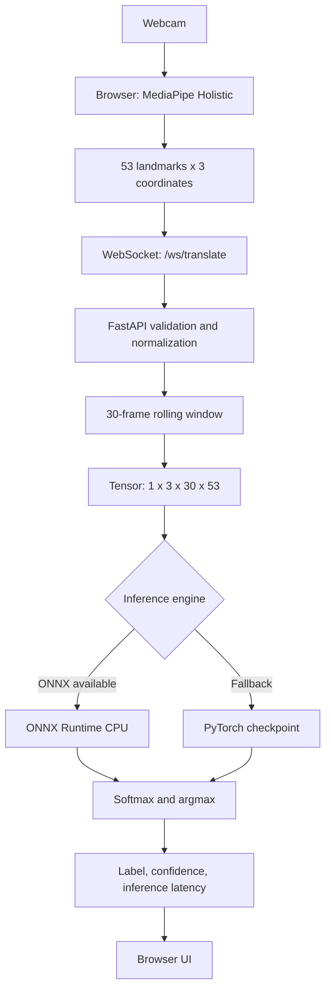

# Sign Language Detector

A real-time, webcam-based **fixed-vocabulary sign-gesture recognition prototype** built with MediaPipe Holistic, FastAPI, WebSockets, and a Spatio-Temporal Graph Convolutional Network (ST-GCN).

> **Scope:** The current implementation classifies a rolling sequence into one of 10 configured labels. It is not a general-purpose ASL translator and does not convert continuous signing into sentences or speech. The included training dataset is procedurally generated, so its results do not establish real-world sign-language recognition accuracy.

## Supported labels

`HELLO` · `THANK_YOU` · `HELP` · `DOCTOR` · `PAIN` · `WATER` · `YES` · `NO` · `PLEASE` · `EMERGENCY`

## Architecture



## Data contract

- 53 nodes: 11 selected upper-body pose landmarks, 21 left-hand landmarks, and 21 right-hand landmarks.
- 3 coordinate channels: x, y, z.
- 30 frames per inference window.
- Model input: `(batch, 3, 30, 53)`.
- Model output: 10 class logits, converted to probabilities by the API.

Landmark ordering must remain consistent across browser extraction, preprocessing, graph definition, and model configuration.

## Technology stack

| Layer | Technologies |
|---|---|
| Browser | HTML, CSS, JavaScript, MediaPipe Holistic |
| API | Python, FastAPI, Pydantic, Uvicorn |
| Streaming | WebSockets |
| Model | PyTorch, custom ST-GCN |
| Inference | ONNX, ONNX Runtime CPU |
| Data | NumPy, OpenCV |
| Testing / container | pytest, Docker |

## Repository structure

```text
.
├── api/                 # FastAPI application and API schemas
├── checkpoints/         # PyTorch and ONNX model artifacts
├── data/processed/      # NumPy features and labels
├── docs/                # Engineering handbook
├── frontend/            # Browser interface and webcam landmark extraction
├── src/
│   ├── graph/           # Skeleton topology and adjacency matrices
│   ├── models/          # ST-GCN blocks and classifier
│   ├── config.py        # Shared dimensions, classes, and paths
│   ├── dataset.py       # Dataset wrapper and fallback synthetic generator
│   ├── extract_landmarks.py
│   ├── train.py
│   └── export_onnx.py
├── tests/
├── generate_dataset.py
├── Dockerfile
├── requirements.txt
└── pytest.ini
```

See [Engineering Handbook](docs/ENGINEERING_HANDBOOK.md) for the file-by-file explanation, model internals, data flow, review findings, troubleshooting, and interview preparation.

## Getting started

Python 3.11 is recommended (the Docker image uses Python 3.11). A webcam and a browser that supports camera access are required.

### Windows PowerShell

```powershell
py -3.11 -m venv .venv
.venv\Scripts\Activate.ps1
python -m pip install --upgrade pip
pip install -r requirements.txt
```

### macOS / Linux

```bash
python3.11 -m venv .venv
source .venv/bin/activate
python -m pip install --upgrade pip
pip install -r requirements.txt
```

### Start the API

```bash
python -m uvicorn api.app:app --reload --host 127.0.0.1 --port 8000
```

Open [http://127.0.0.1:8000](http://127.0.0.1:8000), allow camera access, and start camera tracking.

- `GET /health` reports service and inference-engine status.
- `WS /ws/translate` receives landmark frames and returns predictions.

### Rebuild data and model (optional)

The repository includes processed NumPy data and model artifacts. Rebuilding is not required just to try inference.

```bash
python generate_dataset.py
python -m src.train
python -m src.export_onnx
```

### Tests

```bash
python -m pytest
```

### Docker

```bash
docker build -t sign-language-detector .
docker run --rm -p 8000:8000 sign-language-detector
```

Then open [http://localhost:8000](http://localhost:8000).

## Dataset and evaluation

The supplied processed dataset contains 1,000 generated sequences: 100 per configured class. Each sequence contains 30 frames, 53 nodes, and 3 coordinate channels. The root `generate_dataset.py` synthesizes simplified hand/body trajectories with coordinate jitter. The fallback generator in `src/dataset.py` uses a different, simpler class-dependent synthetic motion pattern when processed arrays are missing.

**These are synthetic examples, not recordings from real signers.** Validation on this data exercises the ML pipeline but cannot support claims about real-world ASL accuracy, signer independence, or generalization. Meaningful evaluation requires consented real recordings and test splits that hold out entire signers.

## Current limitations

- Fixed vocabulary of ten labels; no continuous sentence-level translation.
- Synthetic dataset; real-world recognition performance is not established.
- Reported latency measures model inference, not full camera-to-display latency.
- WebSocket payload validation is basic; production use needs stronger validation and error handling.
- Secure deployments need `wss://` when served behind HTTPS.
- Authentication, rate limiting, and production privacy controls are not implemented.

## Roadmap

- [ ] Collect real, consented, multi-signer training and evaluation data.
- [ ] Add signer-independent evaluation and per-class precision/recall/F1.
- [ ] Add API and WebSocket integration tests.
- [ ] Add ONNX/PyTorch output-parity tests.
- [ ] Improve missing-landmark handling and malformed-payload responses.
- [ ] Add configurable confidence rejection and validated temporal smoothing.
- [ ] Document production deployment, HTTPS/WSS, and security controls.

## Contributing

Issues and pull requests are welcome. Include reproduction steps for bugs and tests for behavior changes. Keep the 53-node landmark ordering and `(B, 3, 30, 53)` model input contract consistent unless all dependent components are updated.

## License

No license has been selected in this repository yet. Until a license is added, do not assume that the code is available for unrestricted reuse.
